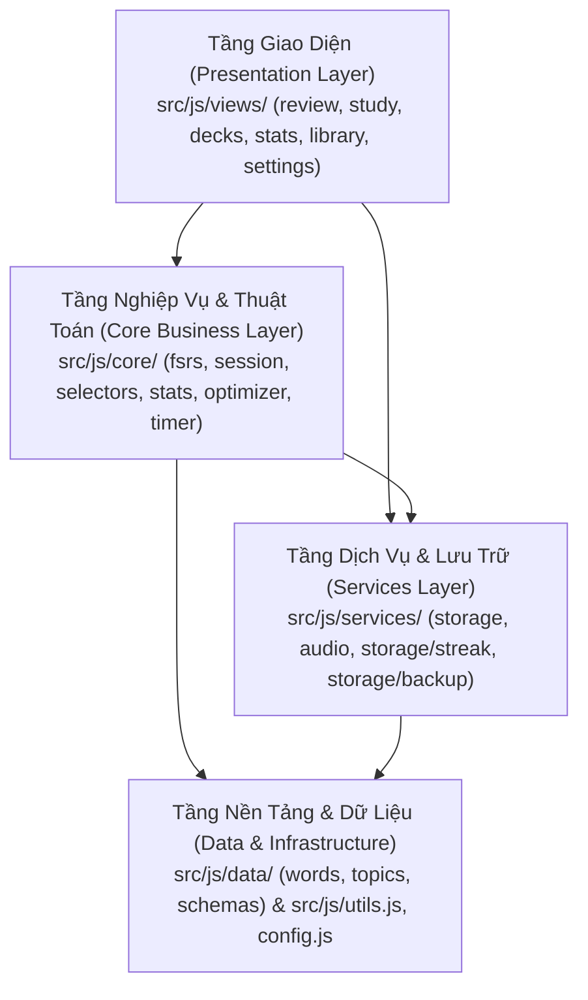
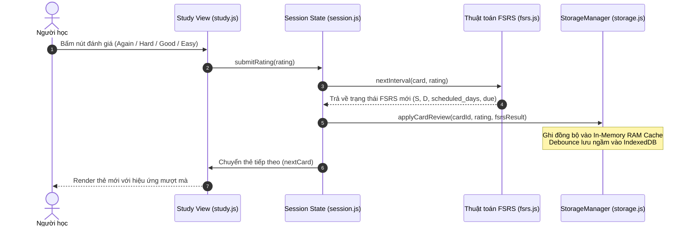

# 🏛️ ARCHITECTURE.md — Kiến Trúc Hệ Thống Flashcard English Pro

> **Tài liệu đặc tả kiến trúc tổng thể, quan hệ module và luồng luân chuyển dữ liệu** của dự án Flashcard English Pro.

---

## 🧭 1. Triết Lý & Mục Tiêu Thiết Kế (Design Philosophy)

1. **Zero-Dependency Vanilla ES6+**: Ứng dụng không sử dụng bất kỳ framework cồng kềnh nào (React, Vue, Angular). Toàn bộ giao diện và luồng điều khiển được viết bằng JavaScript Native Modules tiêu chuẩn.
2. **Offline-First PWA**: Ứng dụng hoạt động 100% không cần kết nối mạng. Tất cả 4.157 từ vựng, 2.582+ ảnh WebP và hệ thống âm thanh TTS/AudioContext đều được lưu trữ và nạp cục bộ.
3. **FSRS-6 Spaced Repetition**: Áp dụng thuật toán khoa học thần kinh hiện đại nhất để tính toán chu kỳ lặp lại ngắt quãng dựa trên 19 tham số tối ưu hóa cá nhân.
4. **60fps Native Performance**: Đọc dữ liệu đồng bộ tức thì từ In-Memory Write-Through Cache, không chờ đợi I/O, lật thẻ 3D mượt mà không khựng giật.

---

## 🧱 2. Kiến Trúc Phân Tầng (Layered Architecture)

Hệ thống được chia thành 4 tầng kiến trúc với luồng phụ thuộc đơn hướng:

### 2.1. Tầng Giao Diện (Presentation Layer — `src/js/views/`)
- Quản lý DOM, lắng nghe sự kiện vuốt chạm cử chỉ và kết xuất HTML.
- Áp dụng mẫu **Facade Barrel**: Tệp chính đóng vai trò cổng điều phối, chia nhỏ các tính năng con thành các thư mục chuyên biệt:
  - `views/study/`: `shell.js`, `autoplay.js`, `prefs.js`, `pomodoro.js`, `summary-modal.js`.
  - `views/decks/`: `subtopics.js` (cấp 2 & 3), `words.js` (cấp 4).
  - `views/stats/`: `journal.js` (nhật ký & calendar), `forecast-modal.js` (dự báo tải ôn tập).
  - `views/library/`: `detail-modal.js` (chi tiết từ & FSRS inspector).
  - `views/review/`: `stat-modals.js` (5 modal phân tích chỉ số trang chủ).
  - `views/modals/`: `goal-modal.js` (lộ trình CEFR & mục tiêu).
  - `views/components/`: `toast.js`, `search.js`, `streak-hub.js`, `custom-study.js`, `optimizer-modal.js`.

### 2.2. Tầng Nghiệp Vụ & Thuật Toán (Core Layer — `src/js/core/`)
- Hoàn toàn tách biệt khỏi DOM (Platform Agnostic).
- `fsrs.js`: Thuật toán FSRS-6 thuần JS (độ bền Stability, độ khó Difficulty, khả năng nhớ Retrievability).
- `session.js`: State Machine điều khiển phiên học Flashcard (hàng đợi FSRS, chuyển thẻ, ghi nhận kết quả).
- `selectors.js` (`DeckManager`): Cỗ máy truy vấn, phân loại từ vựng theo chủ đề, cấp độ CEFR, trạng thái ôn tập.
- `stats.js` (`StatsManager`): Tính toán chỉ số thống kê, tỷ lệ ghi nhớ, phân bổ cấp bậc trí nhớ, chuỗi ngày học.
- `optimizer.js` (`BehavioralOptimizer`): Tự động phân tích phản xạ học tập và tinh chỉnh tham số FSRS ngầm.
- `timer.js` (`StudyTimer`): Bộ đếm thời gian học tập chính xác, tự động dừng khi chuyển tab.

### 2.3. Tầng Dịch Vụ & Ngoại Vi (Services Layer — `src/js/services/`)
- `storage.js` (`StorageManager`): Facade quản lý In-Memory RAM Cache kết hợp IndexedDB và fallback localStorage.
  - `storage/streak.js`: Thuật toán đóng băng, khôi phục và tính toán chuỗi ngày học liên tục.
  - `storage/backup.js`: Nén dữ liệu Nano Tuple, xuất/nhập file sao lưu JSON.
- `audio.js`: Quản lý phát âm Web Speech API và âm thanh thông báo qua Web Audio API.

### 2.4. Tầng Dữ Liệu & Nền Tảng (Data & Infrastructure)
- `src/js/data/`: 4.157 từ vựng, 569 chủ đề phân tầng, đề thi TOEIC và hệ thống Schema xác thực.
- `src/js/config.js`: Lưu trữ toàn bộ hằng số cấu hình, tham số mặc định của hệ thống.
- `src/js/utils.js`: Các hàm tiện ích dùng chung (escape HTML, format thời gian, debounce).

---

## 🔄 3. Luồng Luân Chuyển Dữ Liệu (Data Flow)

### 3.1. Luồng Học & Đánh Giá Thẻ (Study Card Review Flow)

---

## 🛡️ 4. Quy Chuẩn Đảm Bảo Chất Lượng (Quality Assurance Gate)

Dự án thiết lập cơ chế kiểm tra tự động trước khi xuất xưởng:
1. **Kiểm tra cú pháp Native V8 (`test/check.js`)**: Quét toàn bộ 70+ file `.js`, `.css` và dữ liệu từ vựng trong < 1 giây.
2. **Kiểm thử FSRS & Khoảng thời gian (`test/test_fsrs_sync.js`)**: 39 bài test tự động bảo đảm tính chính xác của thuật toán học.
3. **Kiểm thử Cân bằng Quiz (`test/test_quiz_balance.js`)**: 13 bài test xác minh độ ngẫu nhiên và phân phối câu hỏi trắc nghiệm.
4. **Lệnh thực thi toàn bộ test**: `npm test`.
