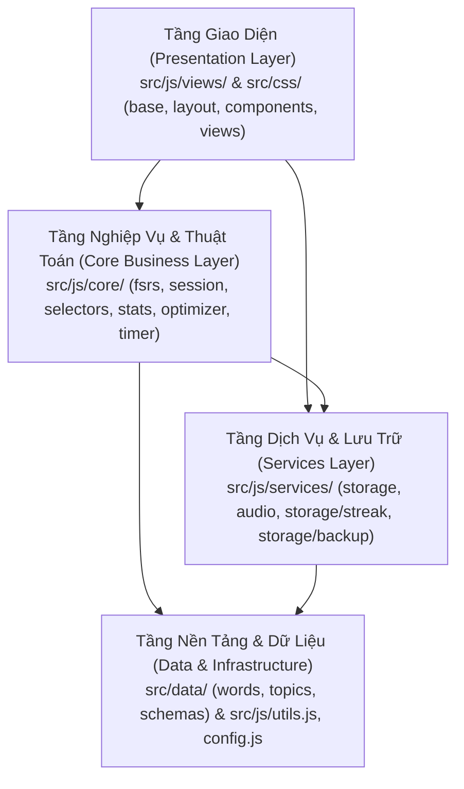
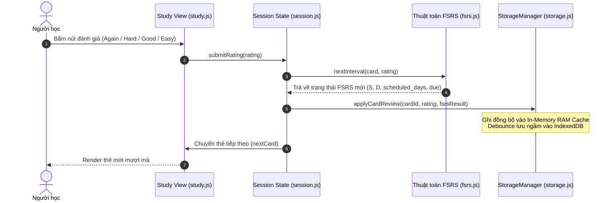

# 🏛️ ARCHITECTURE.md — Kiến Trúc, Quyết Định Kỹ Thuật & Quy Chuẩn Code

> **Tài liệu SSOT về kiến trúc tổng thể, quyết định bất biến (ADR) và quy chuẩn viết code** của dự án **Flashcard English Pro**.

---

## 🧭 1. Triết Lý & Mục Tiêu Thiết Kế (Design Philosophy)

1. **Zero-Dependency Vanilla ES6+**: Không sử dụng framework cồng kềnh (React, Vue, Angular). Toàn bộ viết bằng JavaScript Native Modules tiêu chuẩn.
2. **Offline-First PWA**: Hoạt động 100% không cần mạng. Toàn bộ 4.157 từ vựng, 2.582+ ảnh WebP và hệ thống âm thanh TTS/AudioContext nạp cục bộ.
3. **FSRS-6 Spaced Repetition**: Thuật toán lặp lại ngắt quãng với 19 tham số tối ưu hóa cá nhân.
4. **60fps Native Performance**: Đọc đồng bộ tức thì từ In-Memory Write-Through Cache, lật thẻ 3D mượt mà không khựng giật.

---

## 🧱 2. Kiến Trúc Phân Tầng (Layered Architecture)

Hệ thống chia thành 4 tầng với luồng phụ thuộc đơn hướng:

### 2.1. Tầng Giao Diện (`src/js/views/` & `src/css/`)
- **JS Views**: Quản lý DOM, cử chỉ vuốt chạm và render HTML theo mẫu **Facade Barrel**:
  - `views/study/`: `shell.js`, `autoplay.js`, `prefs.js`, `pomodoro.js`, `summary-modal.js`.
  - `views/decks/`: `subtopics.js` (cấp 2 & 3), `words.js` (cấp 4).
  - `views/stats/`: `journal.js`, `forecast-modal.js`.
  - `views/library/`: `detail-modal.js`.
  - `views/review/`: `stat-modals.js`.
  - `views/modals/`: `goal-modal.js`.
  - `views/components/`: `shell.js`, `toast.js`, `search.js`, `streak-hub.js`, `custom-study.js`, `optimizer-modal.js`.
- **CSS Architecture (`src/css/`)**: Phân tách 4 tầng rõ ràng:
  - `base/`: `tokens.css`, `reset.css`, `animations.css`.
  - `layout/`: `shell.css`, `responsive.css`.
  - `components/`: `modals.css`, `toast.css`, `search.css`, `optimizer.css`, `streak.css`, `custom-study.css`.
  - `views/`: 9 stylesheet riêng cho từng màn hình (`flashcard.css`, `review.css`, `decks.css`, `stats.css`, `library.css`, `settings.css`, `quiz.css`, `reels.css`, `toeic-test.css`).

### 2.2. Tầng Nghiệp Vụ & Thuật Toán (`src/js/core/`)
- Tách biệt hoàn toàn khỏi DOM (Platform Agnostic): `fsrs.js`, `session.js`, `selectors.js`, `stats.js`, `optimizer.js`, `timer.js`.

### 2.3. Tầng Dịch Vụ & Ngoại Vi (`src/js/services/`)
- `storage.js` (`StorageManager`): Facade quản lý In-Memory RAM Cache kết hợp IndexedDB và fallback `localStorage`, cùng `storage/streak.js` và `storage/backup.js`.
- `audio.js`: Web Speech API và Web Audio API.

### 2.4. Tầng Dữ Liệu & Nền Tảng (`src/data/`, `src/js/config.js`, `src/js/utils.js`)
- 4.157 từ vựng, 569 chủ đề phân tầng, đề thi TOEIC và Schema xác thực (`schemas.js`, `validators.js`).

---

## 🔄 3. Luồng Luân Chuyển Dữ Liệu (Study Card Review Flow)

---

## 🛡️ 4. Quy Chuẩn Kiểm Thử Tự Động (Quality Assurance Gate)

1. **`test/check.js`**: Quét V8 AST, Named Exports/Imports, đường dẫn import, biến CSS `var(--...)`, Schema từ vựng và SSOT version trong < 0.5 giây.
2. **`test/test_fsrs_sync.js`**: 39 test cases cho FSRS-6, khoảng thời gian ôn tập, Leech detection, Streak Auto-heal.
3. **`test/test_quiz_balance.js`**: 13 test cases kiểm tra phân phối câu hỏi trắc nghiệm.
4. **Lệnh chạy toàn bộ**: `npm test`.

---

## ⚖️ 5. Các Quyết Định Kiến Trúc Bất Biến (ADR)

- **ADR-001 — In-Memory Write-Through Cache:** Mọi hàm đọc trạng thái (`StorageManager.getCard()`, `getSettings()`) là **hàm đồng bộ (Synchronous)** từ RAM để đảm bảo 60fps; tuyệt đối không biến chúng thành `async/await`. Thao tác ghi cập nhật RAM trước rồi debounce ghi ngầm xuống IndexedDB.
- **ADR-002 — Lịch ôn FSRS không nhồi nhét (`relearnInSession: false`):** Khi bấm *Quên (Again)*, thẻ tăng `lapses++`, chuyển `State.Relearning` và dời sang ngày mai theo FSRS-6 (không lặp vô tận trong phiên trừ khi cấu hình riêng).
- **ADR-003 — Barrel Facade Pattern:** Khi tách module lớn thành thư mục con, tệp gốc giữ tên cũ làm Facade re-export để đảm bảo 100% tương thích ngược.
- **ADR-004 — Thứ tự khai báo ESM:** Toàn bộ `import` nằm ở đầu file, tiếp theo là `export`, sau cùng là state và hàm/class để `test/check.js` phân tích AST chính xác.
- **ADR-005 — Single-Source Version Bump:** Luôn dùng `npm run bump` (không sửa tay `package.json`, `sw.js`, `src/js/config.js`, `index.html`).
- **ADR-006 — Precache PWA ngoại tuyến (`PRECACHE_ASSETS`):** Mọi tệp `.js` hoặc `.css` mới trong `src/` phải được đăng ký vào `PRECACHE_ASSETS` trong `sw.js`.

---

## 📜 6. Quy Chuẩn Viết Code (Coding Standards)

### 6.1. Cấu trúc & Kiến trúc
- **Single Responsibility:** Mỗi module chỉ giữ 1 miền logic; vượt **300–500 dòng** cần xem xét tách module con.
- **Separation of Concerns:** `core/` không chứa DOM (`document`, `window`); `css/` dùng Design Tokens `var(--...)` thay vì hardcode hex trong JS template.
- **Zero Circular Dependencies:** Phụ thuộc một chiều (`Views` ➔ `Core` ➔ `Services` ➔ `Utils/Config`).

### 6.2. Phong cách & Chất lượng
- **Đặt tên:** File `kebab-case.js`, Class `PascalCase`, Hàm/Biến `camelCase`, Hằng số `UPPER_SNAKE_CASE`, State nội bộ `_prefix`.
- **DRY & KISS:** Dùng chung helper ở `src/js/utils.js`; ưu tiên Vanilla ES6+ trực diện, tránh over-engineering.
- **Hàm gọn & An toàn:** Hàm nên < 50 dòng; kiểm tra tham số đầu vào; bọc `try...catch` ở các thao tác IndexedDB/Web Speech/JSON với log `[ModuleName] ...`.
- **No Magic Values:** Tham số cấu hình tập trung tại `src/js/config.js`.

### 6.3. Dữ liệu & Bảo mật
- **Chống XSS:** Luôn dùng `escapeHTML()` từ `utils.js` trước khi chèn chuỗi người dùng vào `innerHTML`.
- **Schema & Riêng tư:** Tuân thủ `src/data/schemas.js`; 100% Offline-First, không gửi dữ liệu ra ngoài và không hardcode key/token.
- **Thao tác nguy hiểm:** Xóa toàn bộ dữ liệu (`clearAllData`) phải yêu cầu xác nhận kép.

### 6.4. Git & Kiểm thử
- Mọi thay đổi phải pass `npm test` trước khi `npm run bump` và commit theo Conventional Commits (`feat(scope): ...`, `fix(scope): ...`, `refactor(scope): ...`, `chore(scope): ...`).
